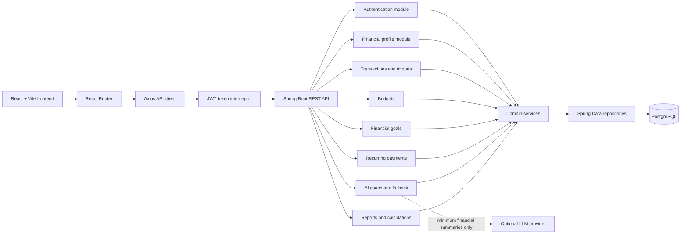
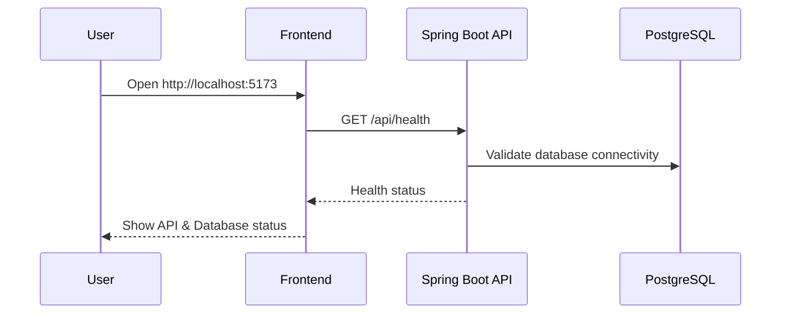
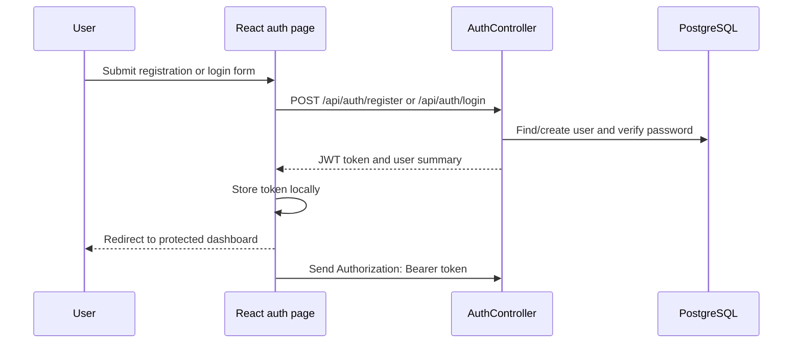

# FinanceFlow — Personal Finance Coach

FinanceFlow is a modular-monolith personal finance application that turns a user's income, expenses, savings, goals, budgets, recurring payments, and transaction history into an understandable living money model.

The project is designed as a full-stack software development submission demonstrating:

- React frontend development
- Spring Boot REST API design
- PostgreSQL persistence
- JWT authentication
- Financial calculations using `BigDecimal`
- Transaction categorization and import workflows
- Goals, budgets, subscriptions, reports, and what-if simulations
- AI-assisted financial coaching with a deterministic fallback
- Responsive data visualization and error handling

> **Implementation status:** The frontend experience and backend MVP contracts are implemented for authentication, strict email validation, profile, dashboard, transaction CRUD, CSV/PDF statement parsing, duplicate prevention, automatic categorization, learned user categorization rules, budget and goal CRUD, subscription creation and confirmation/dismissal, monthly reports, coach fallback responses, and what-if simulations. All visible monetary values use the shared Indian-rupee formatter. Automatic recurring-payment detection, optional LLM integration, frontend build verification, and broader integration-test coverage remain follow-up work. The gap analysis below distinguishes verified functionality from planned hardening so the project does not claim functionality that is not yet present.

---

## 1. Product vision

Most budgeting applications only categorize transactions. FinanceFlow is intended to understand the user's broader financial situation:

```text
Income + expenses + savings + goals + budgets + recurring payments
                              ↓
                    Living money model
                              ↓
       Calculations + alerts + reports + coach explanations
```

The application should help a user answer questions such as:

- How much did I actually save this month?
- What categories are consuming the most money?
- Can I afford to increase a goal contribution?
- Which recurring payments are affecting my monthly capacity?
- What happens if I reduce dining expenses by 30%?
- Why did my savings rate change?

The AI coach must explain calculated application data rather than inventing financial facts. It must not provide specific investment recommendations or guarantee returns.

---

## 2. Technology stack

### Frontend

- React 18
- Vite
- JavaScript/JSX
- Tailwind CSS
- Recharts
- Axios
- React Router
- Lucide React icons

### Backend

- Java 21
- Spring Boot 3.3.x
- Spring Web
- Spring Data JPA
- Spring Security
- JWT authentication
- Maven
- PostgreSQL

### Supporting technologies and status

- Apache Commons CSV for CSV bank statement imports — implemented
- Apache PDFBox dependency is present, but PDF transaction parsing is not implemented yet
- Deterministic coach fallback — implemented; configurable Claude/LLM provider — planned
- Docker Compose for local PostgreSQL — configured, runtime verification requires Docker Desktop
- A migration tool such as Flyway for production-safe schema changes — planned

---

## 3. Architecture

FinanceFlow uses a **modular monolithic architecture**. All modules run in one Spring Boot deployment and share one PostgreSQL database, but responsibilities remain separated by package and domain.



### Backend package responsibilities

```text
com.financecoach
├── config        Security, CORS, application configuration
├── controller    REST endpoints and HTTP concerns
├── dto           Request/response contracts; entities are not exposed directly
├── entity        JPA persistence model and domain enums
├── repository    Database access through Spring Data JPA
├── service       Business logic and financial calculations
├── security      JWT filter, token provider, user principal
├── exception     Domain exceptions and global error handling
├── ai            LLM client, prompt boundaries, deterministic fallback
└── util          Shared parsing, date, hashing, and calculation helpers
```

### Frontend structure

```text
frontend/src
├── api/                 Axios client and API configuration
├── components/
│   ├── auth/            Protected routes
│   ├── common/          Cards, forms, modals, states, charts, toasts
│   └── layout/          Sidebar, top navigation, application shell
├── context/             Authentication/session state
├── lib/                 Currency, date, percentage, and error formatters
├── pages/               Dashboard and domain pages
├── App.jsx              Route configuration
├── main.jsx             React bootstrap and BrowserRouter
└── index.css            Global dark theme and typography
```

---

## 4. End-to-end workflow

### 4.1 Application startup workflow



### 4.2 Authentication workflow



### 4.3 Financial data workflow

```text
1. User creates or imports transactions.
2. Backend validates ownership, amount, type, date, and category.
3. CSV and supported text-based PDF rows are parsed and validated.
4. Import hashes prevent duplicate rows per user.
5. Generic and learned user-specific categorization rules assign categories.
6. Transaction records remain persistent in PostgreSQL.
7. Dashboard/report services aggregate only the authenticated user's records.
8. Budget, goal, subscription, and simulation services derive their calculations.
9. Frontend renders cards, tables, charts, import summaries, and loading/error/empty states.
```

> Scanned or password-protected PDFs and unsupported bank layouts return explicit validation errors. Automatic recurring-payment detection remains a follow-up workflow.

### 4.4 Coach workflow

```text
1. User submits a question or what-if scenario.
2. Backend calculates deterministic values for the authenticated user's records.
3. The current coach returns bounded fallback guidance and never receives credentials or raw statements.
4. Simulations return baseline and projected values without mutating stored transactions.
5. Configurable LLM explanations remain a future provider integration.
```

### 4.5 Monthly report workflow

```text
Selected month
    ↓
Income and expense transaction aggregation
    ↓
Net savings and savings-rate calculation
    ↓
Category spending aggregation
    ↓
Budget comparison
    ↓
Goal progress and recurring-payment summary
    ↓
Previous-month comparison
    ↓
Report DTO consumed by the React charts and summary cards
```

---

## 5. Database model

The current JPA model contains the main entities required by the problem statement:

| Entity | Purpose | Current status |
|---|---|---|
| `User` | Account identity and ownership boundary | Implemented |
| `FinancialProfile` | Monthly income, savings, emergency fund, fixed expenses, savings target | Implemented |
| `Transaction` | Income and expense records with category and import hash | Entity, CRUD API, filters, CSV/PDF import, and duplicate prevention implemented |
| `FinancialGoal` | Target amount, current amount, target date, priority, status | Entity, CRUD API, and monthly-savings calculation implemented |
| `Budget` | Category limit for month/year | Entity, create/list/update/delete API, and spending calculation implemented |
| `Subscription` | Recurring payment details and active state | Entity, list/create, confirm, and dismiss API implemented |
| `CategorizationRule` | Generic and user-specific merchant/category rules | Entity, repository, automatic categorization, and learned correction workflow implemented |

Important persistence rules:

- Monetary values use `BigDecimal`, not floating-point types.
- Records are associated with a user through foreign keys.
- Budgets enforce uniqueness by user, category, month, and year.
- Transaction indexes support user/date, user/category, and user/type queries.
- Imported transactions have an `importHash` field intended for duplicate prevention.
- `ddl-auto: update` is acceptable for local development only; production should use migrations and `ddl-auto: validate`.

---

## 6. Current API status

### Implemented backend endpoints

| Method | Endpoint | Purpose |
|---|---|---|
| `GET` | `/api/health` | Backend health check |
| `POST` | `/api/auth/register` | Create account and initialize profile |
| `POST` | `/api/auth/login` | Authenticate and return JWT |
| `GET` | `/api/auth/me` | Return authenticated user |
| `GET` | `/api/profile` | Load the authenticated user's profile |
| `PUT` | `/api/profile` | Update profile values |
| `GET` | `/api/dashboard/summary` | Monthly financial summary |
| `GET` | `/api/dashboard/spending` | Category spending breakdown |
| `GET` | `/api/transactions` | List transactions with search/type/category/date filters |
| `POST` | `/api/transactions` | Create a transaction |
| `PUT` | `/api/transactions/{id}` | Update an owned transaction |
| `DELETE` | `/api/transactions/{id}` | Delete an owned transaction |
| `POST` | `/api/transactions/import` | Import and deduplicate CSV and PDF statements |
| `GET` | `/api/transactions/categories` | List supported default categories |
| `GET` | `/api/transactions/rules` | List user custom categorization rules |
| `POST` | `/api/transactions/rules` | Create or learn a merchant categorization rule |
| `GET` | `/api/budgets` | List budgets with spending and utilization |
| `POST` | `/api/budgets` | Create a budget |
| `PUT` | `/api/budgets/{id}` | Update an owned budget |
| `DELETE` | `/api/budgets/{id}` | Delete an owned budget |
| `GET` | `/api/goals` | List goals with required monthly savings |
| `POST` | `/api/goals` | Create a goal |
| `PUT` | `/api/goals/{id}` | Update an owned goal |
| `DELETE` | `/api/goals/{id}` | Delete an owned goal |
| `GET` | `/api/subscriptions` | List subscriptions, optionally active-only |
| `POST` | `/api/subscriptions` | Create a subscription |
| `POST` | `/api/subscriptions/{id}/confirm` | Mark an owned subscription active |
| `POST` | `/api/subscriptions/{id}/dismiss` | Mark an owned subscription inactive |
| `DELETE` | `/api/subscriptions/{id}` | Delete an owned subscription |
| `GET` | `/api/subscriptions/detected` | Detect recurring subscriptions from transactions |
| `POST` | `/api/subscriptions/detect` | Run detection and optionally auto-sync subscriptions |
| `POST` | `/api/coach/chat` | AI Coach chat (Google Gemini 3.5 with context grounding) |
| `POST` | `/api/coach/simulate` | Calculate a non-mutating what-if projection |
| `GET` | `/api/reports/monthly` | Return monthly totals, categories, budgets, and comparisons |

### Frontend routes already implemented

| Route | Page |
|---|---|
| `/login` | Login |
| `/register` | Registration |
| `/` | Dashboard |
| `/transactions` | Transactions and imports |
| `/budgets` | Budget tracking |
| `/goals` | Financial goals |
| `/subscriptions` | Recurring payments |
| `/coach` | AI coach and what-if simulator |
| `/reports` | Monthly reports |
| `/profile` | Financial profile |

### Remaining API and product gaps

The following are not yet complete:

```text
POST   /api/transactions/import for PDF statements
POST   /api/transactions/{id}/categorize or equivalent correction workflow
GET    /api/subscriptions with automatically detected recurring payments
POST   /api/coach/chat backed by an optional external LLM provider
```

The frontend uses real API calls and shows loading, empty, or backend-error states rather than fabricating records. The transaction page wires edit/delete actions, import summaries, dynamic categories, and learned-rule management. Budget and goal pages now support edit/delete flows, and the subscription page supports create plus confirm/dismiss actions.

---

## 7. Problem statement coverage audit

### Already present

- React/Vite frontend shell
- Responsive dark finance dashboard design
- Sidebar navigation and protected routes
- JWT authentication flow
- PostgreSQL configuration and JPA entities
- Financial profile persistence
- Dashboard income, expense, net savings, and savings-rate API calculations
- Category spending API calculation
- BigDecimal monetary fields
- Validation annotations on core entities and auth/profile requests
- CORS and stateless security configuration
- Frontend loading, error, and empty states
- Frontend charts using Recharts
- Frontend profile, dashboard, goals, budgets, transactions, subscriptions, reports, and coach screens
- Environment-variable based configuration
- Initial categorization-rule seed data

### Incomplete or missing

#### Backend domain APIs

- Pagination for larger transaction histories
- Additional controller-level contract tests

#### Transaction import and categorization

- Import preview before persistence
- Detailed row-level import errors and correction before saving
- Additional bank-format-specific parser validation

#### Recurring payments

- Detection algorithm using merchant, amount tolerance, and date frequency
- Next expected payment calculation from transaction history
- Automatic suggestion records before confirmation

#### AI coach

- Configurable backend LLM client
- Minimum-summary prompt construction
- Provider timeouts, error handling, and rate-limit handling
- Response labeling for calculated values versus suggestions
- No-stock/no-guarantee policy tests

#### Quality and delivery

- Additional backend unit tests for budgets, goals, imports, simulations, and coach safety
- Controller integration tests with MockMvc
- PostgreSQL/Testcontainers integration tests
- Frontend tests for forms and state transitions
- Database migrations
- Seed/demo data
- API contract documentation or OpenAPI
- CI build pipeline
- Final demonstration script
- Real frontend build verification on a machine with Node.js installed

---

## 8. Recommended implementation roadmap

### Phase A — Complete frontend parity and backend hardening

1. **Completed:** Budget and goal edit/delete flows are wired to the ownership-scoped APIs.
2. **Completed:** Subscription creation and confirm/dismiss controls are wired to the backend.
3. Add controller-level contract tests and consistent pagination.
4. Return stable response shapes matching the existing frontend.
5. Add API documentation for the verified endpoint surface.

### Phase B — Finish transaction intelligence

1. Add import preview before persistence.
2. Add detailed row-level import errors and correction before saving.
3. Add additional bank-format-specific parser validation.
4. Expand parser and categorization integration tests.

### Phase C — Implement calculations as testable services

Recommended calculation rules:

```text
Total Income = sum(INCOME transactions for selected period)
Total Expenses = sum(EXPENSE transactions for selected period)
Net Savings = Total Income - Total Expenses
Savings Rate = 0 when income is zero
              otherwise Net Savings / Total Income * 100

Budget Remaining = Monthly Limit - Amount Spent
Budget Utilization = 0 when limit is zero
                    otherwise Amount Spent / Monthly Limit * 100

Goal Remaining = max(Target Amount - Current Amount, 0)
Required Monthly Savings = Goal Remaining / Remaining Months
```

The goal service should explicitly handle:

- Completed goals
- Goals whose target date has passed
- Goals with zero remaining amount
- Goals with no feasible remaining months
- Negative monthly cash flow

### Phase D — Finish coach and simulations

- Calculate simulation results without mutating transactions.
- Support income delta, expense delta, category percentage reduction, and fixed-expense increase.
- Return baseline and projected values together.
- Calculate projected goal completion dates only when projected monthly savings is positive.
- Use the LLM only for explanations and suggestions grounded in returned calculations.

### Phase E — Production hardening

- Add Flyway migrations.
- Remove hard-coded development secrets.
- Add refresh-token or short-lived-token strategy if required.
- Add request rate limiting for auth and coach routes.
- Add structured logs without sensitive financial data.
- Add CORS allowlist validation.
- Add CI for Maven tests and frontend build.
- Add OpenAPI documentation.

---

## 9. Additional features that would strengthen the submission

These are useful extensions after the required MVP is complete:

### High-value additions

- Dashboard date-range comparison: current month versus previous month
- Spending anomaly alerts for category increases
- Emergency-fund runway: months covered by current savings
- Goal feasibility indicator based on monthly free cash flow
- Budget rollover option
- Import preview with row-level correction before saving
- Export filtered transactions as CSV
- Printable/PDF monthly report
- Notification center for budget overruns and upcoming subscriptions
- Recurring payment calendar

### Strong demonstration features

- “What changed this month?” insight card
- A guided first-run setup checklist
- Demo mode with clearly labeled sample data
- Before/after simulation comparison chart
- Explain-this-number action beside every major metric
- Financial health score with transparent component weights
- Accessibility mode with high contrast and reduced motion

### Security and privacy improvements

- Never send names, emails, passwords, or raw statements to the LLM provider.
- Redact merchant text when it is not required for the question.
- Log provider request metadata, never prompt financial contents.
- Add a user-facing data deletion flow.
- Add export and account deletion controls.
- Document local-only development mode separately from production deployment.

---

## 10. Local development

### Prerequisites

- Java 21+
- Maven 3.9+
- Node.js 20+
- npm
- Docker Desktop

### 10.1 Configure environment

Copy the template:

```powershell
Copy-Item .env.example .env
```

Review database and JWT values before use. Never commit `.env` or real API keys.

### 10.2 Start PostgreSQL

```powershell
docker compose up -d postgres
docker compose ps
```

Default development database values:

```text
Host:     localhost
Port:     5432
Database: financecoach
User:     postgres
Password: postgres
```

### 10.3 Run the backend

```powershell
cd backend
mvn clean verify
mvn spring-boot:run
```

The API runs on `http://localhost:8080`.

Health check:

```powershell
Invoke-RestMethod http://localhost:8080/api/health
```

### 10.4 Run the frontend

In a second terminal:

```powershell
cd frontend
npm install
npm run dev
```

Open `http://localhost:5173`.

### 10.5 Build the frontend

```powershell
cd frontend
npm run build
```

---

## 11. Security notes

- The frontend never contains the LLM API key.
- Axios attaches the JWT as a Bearer token after login.
- Backend routes other than health and authentication require authentication.
- Every domain service must verify that the requested record belongs to the authenticated user.
- Development defaults in `application.yml` and `.env.example` must be replaced before deployment.
- `ddl-auto: update` should not be used for production databases.
- Uploaded PDFs and CSVs should be size-limited, validated, and processed as untrusted input.

---

## 12. Testing strategy

### Backend unit tests

Test calculation services with deterministic inputs:

- Zero income
- Negative net savings
- Multiple income transactions
- Category totals
- Budget overrun
- Goal completed
- Goal past due
- Goal with zero remaining amount
- Simulation that changes only projected values

### Backend integration tests

Use MockMvc or Testcontainers to verify:

- Registration and login
- Unauthorized access rejection
- User ownership isolation
- Profile update validation
- Transaction import duplicate prevention
- Correct HTTP status codes

### Frontend checks

- `npm run build`
- Login/register form validation
- Protected-route redirect
- Loading/error/empty states
- Chart rendering with empty and populated data
- Modal submit/cancel flows
- Mobile sidebar navigation

---

## 13. Suggested demonstration script

1. Start PostgreSQL, backend, and frontend.
2. Register a new user.
3. Open Financial Profile and enter monthly income, fixed expenses, savings, and emergency fund.
4. Add several income and expense transactions.
5. Show the dashboard summary and category chart.
6. Create a food or transport budget.
7. Create a savings goal with a target date.
8. Demonstrate goal progress and monthly savings required.
9. Import a small supported CSV statement and show duplicate protection.
10. Correct one category and demonstrate the learned categorization rule.
11. Add or confirm a recurring subscription.
12. Run a what-if simulation that reduces a spending category.
13. Open the coach and ask why the savings rate changed.
14. Open the monthly report and show spending versus budget.
15. Explain that the coach uses minimum financial summaries and falls back safely when the provider is unavailable.

---

## 14. Repository hygiene

Generated build output should not be committed:

```text
backend/target/
frontend/node_modules/
frontend/dist/
.env
```

Before committing:

```powershell
git status
git diff --check
```

Recommended commit style:

```text
feat: complete transaction and financial planning workflows
fix: validate ownership for budget updates
 test: cover zero-income savings calculations
 docs: update architecture and demonstration workflow
```
